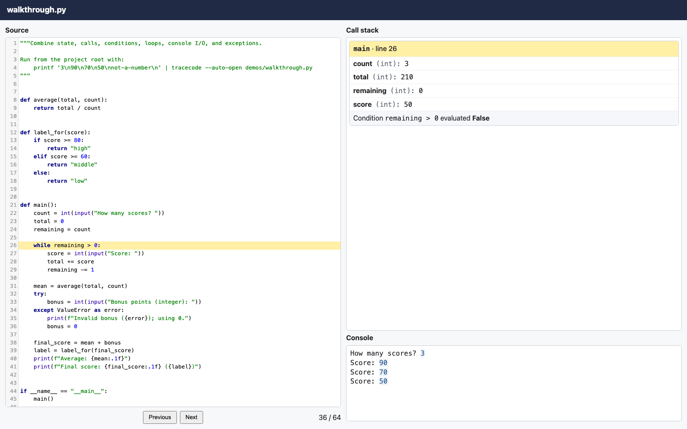

# tracecode

`tracecode` records the execution of a Python script to create a standalone HTML viewer. 

It is intended for instructors who want to make a program's execution visible:

- step through the source code forward and backward
- jump forward or backward to any line of code
- see variable values
- observe function call mechanics
- see console input/output at each step
- observe `if`, `elif`, and `while` condition outcomes
- watch exceptions unwind the call stack

Output HTML files are completely self-contained and shareable. 

Check out the interactive [live demos](https://byu-cs-course-ops.github.io/tracecode/).

[](https://byu-cs-course-ops.github.io/tracecode/demos/walkthrough.html)

## Installation

Requires Python 3.12 or later.

To install:

```sh
pip install tracecode
```

## Use

Run a script with the `tracecode` command:

```sh
tracecode --auto-open path/to/script.py
```

The HTML trace is written next to the script, with the same name and an `.html` extension. `--auto-open` opens it in a browser. Arguments after the script name are passed to the script:

```sh
tracecode path/to/script.py first-argument
```

## Recording a selected function

`prepare_file()` instruments and compiles a file without executing it. Execute the
prepared source in a namespace outside a recorder to define its functions without
recording module setup, then activate a `TraceRecorder` around the function call:

```python
from tracecode import TraceRecorder, prepare_file

path = "student.py"
program = prepare_file(path)
namespace = {"__name__": "_student_load", "__file__": path}
program.execute(namespace)  # module setup runs; no recording is active

with TraceRecorder(target_file=path) as recorder:
    result = namespace["solve"](argument)
```

Instrumented condition and call hooks are transparent outside an active recorder.
The CLI uses the same prepared source but executes the module inside the recording
context, so it continues to record the whole script. See
`.agents/scratch/function_capture_demo.py` for a runnable selective-recording demo.


